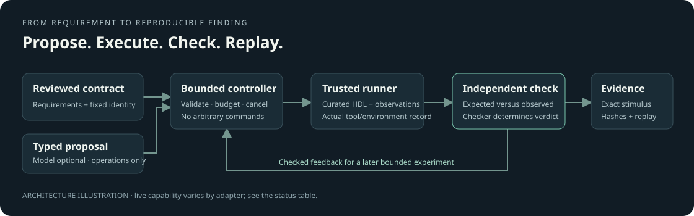

<div align="center">

# VerifForge

**Investigate RTL behavior with bounded experiments, independent checks, and replayable evidence.**

[](https://github.com/desanv01/VerifForge/actions/workflows/ci.yml)

[Quick start](#quick-start) · [Workflow](#workflow) · [Current capabilities](#current-capabilities) · [Development](#development) · [Documentation](#documentation)

</div>



<p align="center"><em>Original architecture illustration · not a product screenshot or execution evidence.</em></p>

VerifForge is a local investigation workbench for digital hardware and engineering-tool failures. Start from a reviewed behavioral contract, run controlled experiments, inspect expected versus observed behavior, and retain the exact stimulus and evidence needed to replay a finding.

The model proposes experiments. The independent checker determines the verdict. A completed execution can contain a mismatch, timeout, or build failure; a passing result establishes only the checked scope.

## Workflow

| Step | What happens | What stays inspectable |
|---|---|---|
| Define | Bind a curated source revision to reviewed requirements and a checker | Contract, parameters, source and checker identities |
| Plan | Select typed stimulus and finite resource limits | Exact operations, seed, objectives and budget |
| Execute | Dispatch to the trusted Linux simulator worker | Tool versions, execution status, logs and observations |
| Check | Compare observations with an independent reference model | Expected/observed values, verdict and failure signature |
| Reproduce | Replay, reduce or export a curated finding | Original evidence, fresh attempts and remaining uncertainty |

Deterministic FIFO execution and replay require no model key. Model-driven planning is optional and its live acceptance is deferred. The planner cannot introduce shell commands, choose arbitrary files, change the active checker, or enlarge its own budget.

## Current capabilities

Active development, as of 24 October 2026. These statuses describe scoped local evidence, not a completed release or benchmark result.

| Area | Available today | Boundary / remaining work |
|---|---|---|
| FIFO verification | Real correct-fixture pass, curated reset-mutant mismatch, exact replay and independent checking | Only installed curated fixtures; no arbitrary RTL upload support |
| Evidence workflows | Curated local replay, bounded reduction, export and candidate-validation evidence accepted | Real API export/download accepted on the tested runtime image; exact API replay passed on that image and browser integration remains pending |
| API and local runtime | FIFO runtime baseline plus backup, migration and real export/download accepted on the tested image | Exact API replay accepted; complete browser workflow remains pending; health is not functional verification |
| Workbench | Local React interface for contracts, campaigns, traces and artifacts | Complete browser-to-replay/export qualification remains in progress |
| Meta planner | Typed provider adapter, bounded controller, cancellation-aware local bridge and CLI tested with mocks/controlled processes | No API key configured; live inference and real model feedback are deferred |
| Arithmetic pipeline | Real WIDTH=8, latency=2 directed checks accepted: correct multiplier plus latency and data mutants | Three scoped simulator cases passed; broader coverage and API integration remain separate |
| AXI-Lite | Bounded peripheral schema and oracle delivered with 79 pure tests | Independent contract review accepted; runner source work underway; no live AXI execution accepted |
| Vivado investigation | Bounded log import and curated candidate preparation | **Import-only**; no live Vivado, timing, equivalence or functional-repair claim |

There is no hosted application release or general-purpose code-execution service. A successful build is not functional correctness, and a timeout is not automatically a design defect.

## Quick start

Use **Docker Engine with Compose v2** (Docker Desktop with Linux containers on Windows), **Git**, and **Node.js 24 / npm** for the web application. Source development also uses **Python 3.12** and **uv**. The container supplies the supported Verilator/cocotb combination; native Windows simulation is unsupported.

From a new checkout:

```sh
git clone https://github.com/desanv01/VerifForge.git
cd VerifForge

# Build the simulator base before the application image.
docker build -t veriforge-rtl:dev -f infra/rtl/Dockerfile .
docker compose up -d --build
docker compose ps -a
```

In a second terminal, from the repository root:

```sh
cd apps/web
npm ci
npm run dev
```

Open the [local workbench](http://127.0.0.1:5173). The API binds to [127.0.0.1:18000](http://127.0.0.1:18000/api/health), and Vite proxies `/api` there. Review the installed FIFO contract before creating and starting an experiment. Compilation counts toward its wall-time budget; cold builds need more time than the default 30-second runner allowance.

This is a local development recipe for the current checkout. It does not certify every newer API workflow. See [local runtime setup](docs/project/LOCAL_RUNTIME.md) for migrations, logs, runtime limitations and image updates, and [FIFO toolchain setup](docs/project/RTL_TOOLCHAIN.md) for direct execution/replay. Docker must be able to fetch the declared base images and dependencies during a first build.

Optional local configuration is documented in [.env.example](.env.example). Keep real values in an ignored local file; no model key is needed for deterministic use. The provided local database defaults and single local identity are for loopback development, not remote exposure.

To stop services while retaining local data:

```sh
docker compose stop
```

Named volumes preserve database history and artifacts. Removing volumes deletes that history.

## How it works

- **One investigation engine:** the Python backend separates contracts, campaign control, trusted adapters, independent checking and evidence workflows.
- **Independent authority:** reviewed contracts and checker identities remain fixed during an investigation. Planner intent and requested coverage never substitute for observed results.
- **Durable execution records:** PostgreSQL holds campaign authority; Valkey/RQ delivers bounded work to a separate worker. Attempts retain their own results and artifacts.
- **Replay without inference:** stored typed stimulus, source/checker/contract hashes and tool evidence let a finding be inspected and replayed independently of a new model call.

The frontend uses React, Vite, TypeScript and TanStack Query. The initial RTL path uses cocotb and Verilator. Meta and Vivado integrations retain explicit unavailable/import-only states where live acceptance is missing.

## Development

Install the locked Python environment from the repository root:

```sh
uv sync --locked --dev
uv run --no-sync pytest tests/contracts -q
```

For the frontend:

```sh
cd apps/web
npm ci
npm test
npm run typecheck
npm run build
```

Choose tests for the component being changed. HTTP/async tests need local socket access; planner tests can launch controlled test processes. Real simulator and runtime suites have separate prerequisites and are not interchangeable with mock-provider or SQLite checks. See [CONTRIBUTING.md](CONTRIBUTING.md) for evidence expectations and [the CI workflow](.github/workflows/ci.yml) for the exact selected checks. The badge reports GitHub workflow status; it does not attest to live Meta, Vivado, arithmetic, or full runtime acceptance.

## Repository layout

```text
apps/web/                 Local React workbench
src/veriforge/            Contracts, engine, API, adapters, planner and evidence
targets/                  Curated HDL fixtures
tests/                    Component, acceptance and opt-in integration checks
infra/                    Simulator and application container definitions
migrations/               Database migrations
docs/project/             Interfaces, setup, support boundaries and implementation plan
```

## Documentation

| Start here | Reference |
|---|---|
| Local services and workbench | [Runtime](docs/project/LOCAL_RUNTIME.md) · [UI](docs/project/UI.md) |
| Contracts and adapters | [Shared interfaces](docs/project/INTERFACES.md) · [Adapter registry](docs/project/ADAPTERS.md) |
| Execution and evidence | [FIFO toolchain](docs/project/RTL_TOOLCHAIN.md) · [Evidence workflows](docs/project/EVIDENCE.md) · [API](docs/project/API.md) |
| Additional integrations | [Arithmetic](docs/project/ARITHMETIC.md) · [Meta planner](docs/project/META_INTEGRATION.md) · [Vivado import](docs/project/VIVADO.md) |
| Intended release scope | [Implementation gameplan](docs/project/IMPLEMENTATION_GAMEPLAN.md) |

## Contributing and security

Please include the affected contract, exact reproduction, tool versions and verification basis when reporting a problem. Separate mocked results from actual tool execution. See [CONTRIBUTING.md](CONTRIBUTING.md) and [SECURITY.md](SECURITY.md); never put credentials or private project evidence in public issues.

License selection is pending. No project license or license badge is asserted here.
