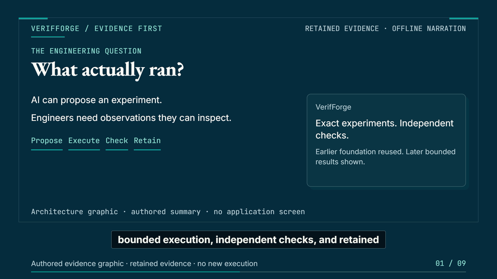
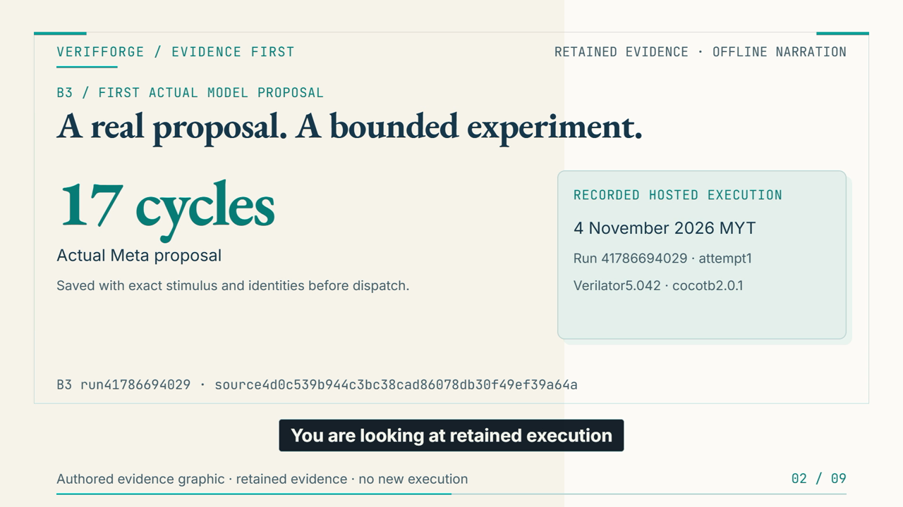
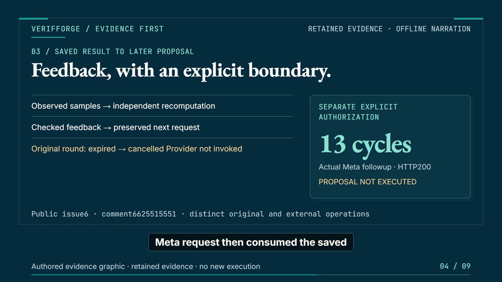
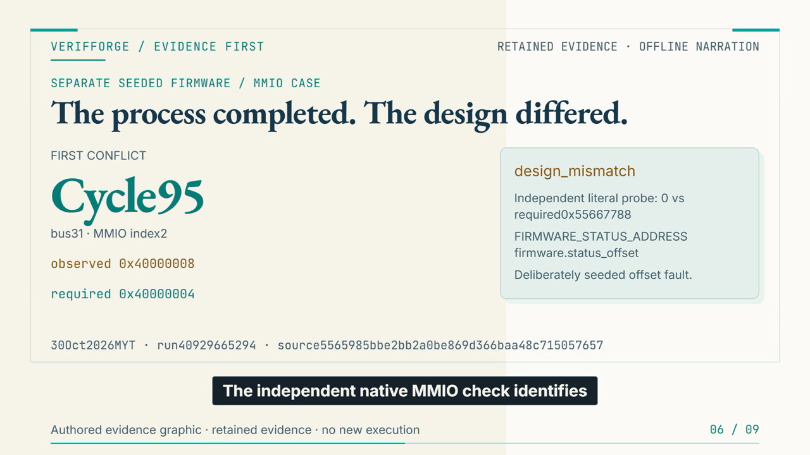
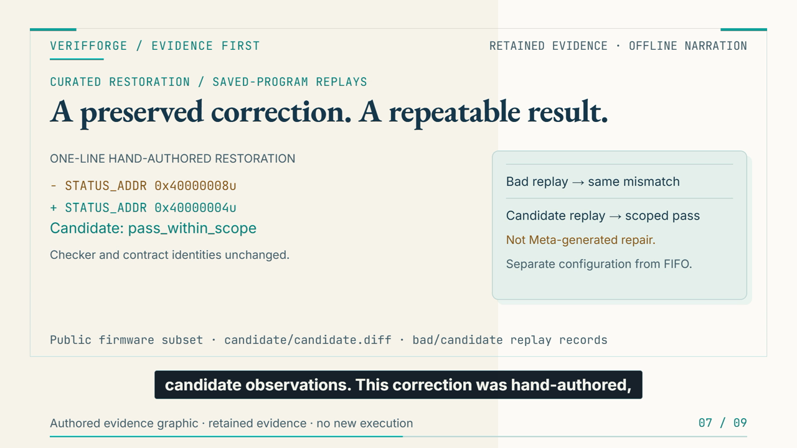
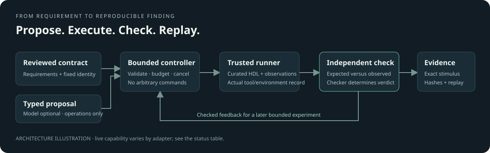

<h1 align="center">VerifForge</h1>

<p align="center">
  <strong>Propose the experiment. Check the result.</strong><br />
  AI-guided engineering experiments, independent verdicts, and replayable evidence.
</p>

<p align="center">
  Built for the <a href="https://cerebralvalley.ai/e/meta-ai-developer-hackathon">Meta Global AI Developer Hackathon 2026</a><br />
  Push the Frontier · Indie Developer Track · SkyNet / Desan Vasu
</p>

<p align="center">
  <a href="https://youtu.be/9nSpILaVUCE"></a>
  
  <a href="https://github.com/desanv01/VerifForge/actions/workflows/ci.yml"></a>
  <a href="LICENSE"></a>
</p>

<p align="center">
  <a href="#features">Features</a> ·
  <a href="#demo">Demo</a> ·
  <a href="https://youtu.be/9nSpILaVUCE">Watch video</a> ·
  <a href="#get-started">Get started</a> ·
  <a href="#meta-model-api">Meta Model API</a> ·
  <a href="docs/project/README.md">Documentation</a>
</p>

<p align="center">
  <a href="https://youtu.be/9nSpILaVUCE"></a>
  <br /><sub>Frame from the three-minute evidence walkthrough · authored graphics presenting retained engineering results.</sub>
</p>

## Why VerifForge

An AI can suggest a useful test. Engineers still need to know what actually ran, what was observed, and why the conclusion should be trusted.

VerifForge connects typed experiment proposals to bounded engineering tools and independent checks. Source, stimulus, checker and contract identities stay attached to the result, so a proposal, an execution status and a design verdict can be inspected separately.

## Features

<table>
<tr>
<td width="50%" valign="top">

### Make the next test concrete

Turn a verification objective into typed stimulus with explicit operations and finite budgets. The demonstrated Meta proposal became a 17-cycle FIFO experiment.

</td>
<td width="50%" valign="top">

### Keep the verdict independent

Compare native observations with an immutable checker. A process can complete successfully while the checked design behavior contains a mismatch.

</td>
</tr>
<tr>
<td width="50%" valign="top">

### Carry checked feedback forward

Persist the checked observations and their identities. In the recorded chain, a subsequent actual Meta request used that feedback to propose another experiment.

</td>
<td width="50%" valign="top">

### Find the first concrete conflict

The separate seeded firmware example identifies the first incorrect STATUS register access at cycle 95, with expected and observed MMIO addresses.

</td>
</tr>
<tr>
<td width="50%" valign="top">

### Revisit the exact experiment

Retain stimulus, source, checker, contract and tool identities. The firmware example includes saved-program replays of the bad and corrected observations.

</td>
<td width="50%" valign="top">

### Inspect the evidence behind a claim

Follow source-linked summaries to identified hosted runs and preserved result records. Curated corrections, model proposals and actual tool observations keep distinct origins.

</td>
</tr>
</table>

## Demo

**[Watch the three-minute engineering walkthrough on YouTube →](https://youtu.be/9nSpILaVUCE)** · [Demo and evidence guide](docs/project/DEMO.md)

The film presents retained execution evidence through narrated, authored graphics. It follows two distinct engineering examples:

1. An actual **muse-spark-1.3** response proposes a **17-cycle FIFO experiment**.
2. A hosted native run executes that stimulus; the independent checker returns **`pass_within_scope`**.
3. Checked, persisted feedback reaches a separately authorized actual Meta call, returning a **13-cycle proposal that was not executed**.
4. A separate firmware/MMIO example reveals a **seeded STATUS-address mismatch**.
5. A **hand-authored one-line correction** passes under the unchanged checker and contract, with saved-program replay evidence.

<table>
<tr>
<td width="50%" valign="top">
  <a href="docs/assets/demo/proposal.png"></a>
  <p><strong>A real typed proposal.</strong> Exact stimulus and identities are saved before dispatch.</p>
</td>
<td width="50%" valign="top">
  <a href="docs/assets/demo/feedback.png"></a>
  <p><strong>Feedback with an explicit boundary.</strong> The original round expired; the later actual proposal remains unexecuted.</p>
</td>
</tr>
<tr>
<td width="50%" valign="top">
  <a href="docs/assets/demo/firmware.png"></a>
  <p><strong>A concrete native mismatch.</strong> Execution status and design verdict tell different parts of the story.</p>
</td>
<td width="50%" valign="top">
  <a href="docs/assets/demo/replay.png"></a>
  <p><strong>A curated correction and replay.</strong> The checker and contract stay fixed; the correction is hand-authored.</p>
</td>
</tr>
</table>

[Frame provenance →](docs/assets/demo/README.md) · [Meta/FIFO evidence](docs/evidence/planner/2026-11-05/README.md) · [Firmware evidence](docs/evidence/firmware/2026-10-30/README.md)

## Get started

### Explore the recorded results

Start with the [video](https://youtu.be/9nSpILaVUCE) and [evidence guide](docs/project/DEMO.md). Inspecting the public records needs no provider key, paid credits or new simulator run.

### Run the local development stack

You'll need **Git**, **Docker Engine with Compose v2** (Linux containers on Windows), and **Node.js 24 / npm** for the web workbench. The container supplies the supported Verilator/cocotb toolchain.

```sh
git clone https://github.com/desanv01/VerifForge.git
cd VerifForge
docker build -t veriforge-rtl:dev -f infra/rtl/Dockerfile .
docker compose up -d --build
docker compose ps -a
```

In a second terminal, from the repository root:

```sh
cd apps/web
npm ci
npm run dev
```

Open **http://127.0.0.1:5173**. The API health endpoint is **http://127.0.0.1:18000/api/health**, with `/api` proxied by Vite. Deterministic curated FIFO use needs no model key. Compilation counts toward execution budgets; use the [runtime guide](docs/project/LOCAL_RUNTIME.md) for migrations, logs and image updates, and the [RTL toolchain guide](docs/project/RTL_TOOLCHAIN.md) for direct execution and replay. These are local development instructions; the film inspects separately recorded results.

Stop the services while retaining their data:

```sh
docker compose stop
```

Keep real credentials in an ignored local file. The loopback defaults are intended for local development. [Configuration example →](.env.example)

## Meta Model API

The demonstrated planner calls **`muse-spark-1.3` through the Meta Model API** to propose typed engineering experiments. Model responses are validated against an allowed schema; the planner does not choose arbitrary files, inject shell commands, replace a checker or enlarge its own budget.

The first accepted call produced the executed 17-cycle FIFO stimulus. Its checked observations were imported, independently checked again and persisted. The original bounded followup expired without invoking the provider and was cancelled; a separately authorized actual call then consumed the saved feedback and returned the unexecuted 13-cycle proposal.

The initial experiment reset an empty FIFO and passed its checked scope; it did not expose the known reset defect. The separate firmware correction was hand-authored. [Model identities, lineage and results →](docs/evidence/planner/2026-11-05/README.md)

## Built with

| Interface | Engine & API | Persistence & jobs | Engineering tools & model |
| --- | --- | --- | --- |
| React · TypeScript · Vite · TanStack Query | Python 3.12 · FastAPI · typed contracts | PostgreSQL · Valkey · RQ · retained artifacts | Verilator · cocotb · PicoRV32/Spike · Meta Model API |

One investigation engine keeps contracts, bounded execution, independent checking and evidence records separate. Curated RTL, RISC-V and firmware configurations have their own source-linked execution records; FPGA/PCB adapters and their acceptance scopes are documented individually.

## Architecture



<p align="center"><sub>Original architecture illustration · proposal, execution and verdict remain distinct.</sub></p>

## Scope and contributions

Our contribution to the **Meta Global AI Developer Hackathon 2026** is the integration behind the recorded Meta/FIFO feedback chain and firmware/MMIO check/replay path, demonstrated on **4 November** and **30 October**. The deterministic FIFO/platform foundation predates the event; PicoRV32 and execution tools remain upstream work. [Dated contribution ledger →](docs/project/EVENT_CONTRIBUTIONS.md)

The demonstration establishes these curated simulation cases and their retained evidence. Full browser/application qualification, broader recovery and clean release reproduction are separate gates; the film is an evidence walkthrough, not a live UI session. [Detailed supported configurations and boundaries →](docs/project/SUPPORT_MATRIX.md)

**Team SkyNet** · **Desan Vasu** · Solo Indie entrant. [Source, tools and attribution →](docs/project/PROVENANCE.md)

## Documentation

- [Documentation index](docs/project/README.md)
- [Demo, results and evidence links](docs/project/DEMO.md)
- [Local runtime setup](docs/project/LOCAL_RUNTIME.md) · [RTL execution and replay](docs/project/RTL_TOOLCHAIN.md)
- [Shared interfaces](docs/project/INTERFACES.md) · [Adapters](docs/project/ADAPTERS.md) · [Evidence](docs/project/EVIDENCE.md)
- [Meta integration](docs/project/META_INTEGRATION.md) · [Firmware](docs/project/FIRMWARE.md)
- [Support matrix](docs/project/SUPPORT_MATRIX.md) · [Contribution ledger](docs/project/EVENT_CONTRIBUTIONS.md) · [Provenance](docs/project/PROVENANCE.md)

## Feedback

Found a problem or have a useful engineering case? [Open an issue](https://github.com/desanv01/VerifForge/issues) with expected behavior, exact stimulus, tool versions and reproducible steps. Use curated or permission-cleared examples; keep credentials and private designs out of public reports. See [CONTRIBUTING.md](CONTRIBUTING.md) and [SECURITY.md](SECURITY.md).

## License

Original first-party VerifForge code is licensed under **GNU AGPL version 3 only** ([AGPL-3.0-only](LICENSE)), copyright (C) 2026 Desan Vasu. Third-party code, tools, dependencies, hardware designs and assets retain their own rights and notices, including PicoRV32's ISC header and the [Spike BSD-3-Clause notice](targets/riscv/upstream/SPIKE-LICENSE). See [provenance](docs/project/PROVENANCE.md).
