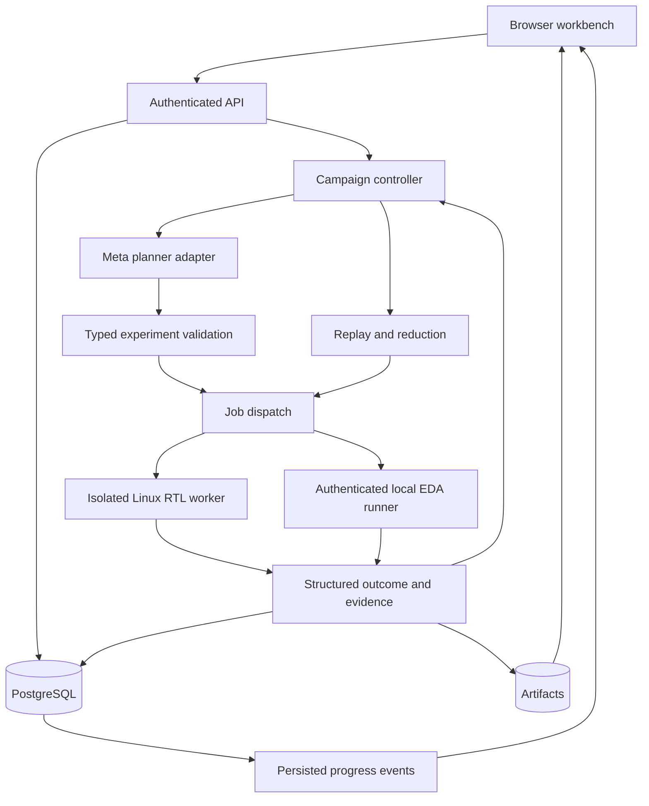

# VerifForge implementation and execution gameplan

## Current direction — 30 October 2026

VerifForge connects specifications, source files, engineering tools and test results to investigate failures, propose repairs and independently validate them. The active execution order is: reliable RTL diagnosis and checked repair; one pinned RISC-V core with an independent architectural reference; firmware/register-map and boot investigation; actual Vivado project/timing/CDC investigation; actual KiCad ERC/DRC/connectivity and exact-part mapping; then independently sourced cross-checks across board, constraints, RTL and firmware. These capabilities belong to one investigation product and retain explicit supported configurations and Import / Execute / Repair gates.

The [support matrix](SUPPORT_MATRIX.md) and [master checklist](MASTER_CHECKLIST.md) record actual acceptance. Source, unit tests, report imports and recorded playback do not establish new tool execution. The model proposes typed experiments; independent immutable checks determine each scoped verdict. Preserve original revisions, exact stimulus, source/checker/contract identities, native evidence and resource/recovery state. Generated artifacts sharing one source do not establish independent agreement.

Keep the existing modular Python backend, React/TypeScript/Vite workbench, PostgreSQL and worker queue. Extend domain adapters and shared evidence records rather than rewriting the application. The workbench remains local. Analog/ASIC investigations are stretch work after the six primary sequences and submission-critical gates; broader software/desktop adapters remain deferred.

Submission preparation targets **5 November 2026, 10:00 AM MYT** and includes real Meta feedback, reproducible evidence, known limitations, provenance and the three-minute demonstration. Live Meta access is currently unavailable; independent work continues. Public source delivery uses focused reviewed commits, CI and PRs. Application deployment and final external submission remain separate actions.

The October23 architecture below is retained as the historical foundation. Its initial two-workflow scope and planning-time status are superseded by this direction and the current acceptance records; applicable technical contracts remain in force.

## Historical architecture baseline

Planning baseline: October 23, 2026. Status: proposed architecture and execution plan; application implementation and benchmarks have not been performed in this planning turn.

This document consolidates the three supplied responses: the technical options survey, the RTL scenarios, and the software/proprietary-tool scenarios. It is the reference for subsequent phase-by-phase implementation. Decisions below are working defaults, not claims that the user already selected every technology.

## 1. Product and release boundary

VerifForge is an AI-assisted investigation workbench for digital hardware and engineering toolchains. It converts a reported problem or a verification objective into controlled experiments, independently checked outcomes, reproducible evidence, and optionally a validated repair candidate.

The initial release has two workflows sharing one investigation record:

1. RTL verification: review a behavioral contract, generate stimulus, simulate, check, reduce failures, replay, explain, and validate candidate patches.
2. EDA investigation: reproduce an existing build/tool failure, inspect structured reports, isolate causes, test project-level repairs or workarounds, and export a vendor-ready reproduction when needed.

The first release aims for three RTL families: synchronous FIFO, fixed-latency arithmetic pipeline, and a bounded AXI-Lite register peripheral. It also aims for one real Vivado project-repair demonstration, subject to verifying a working local installation, the relevant device support, and an available reproducible case. Vendor-internal crash reduction is an extension; an authentic proprietary-tool defect cannot be assumed to be discoverable during the event.

The general software vision remains: Python/numerical code, MATLAB, CAD scripts, compiler discrepancies, web applications, and closed desktop software can use future adapters. They require their own execution interfaces and correctness checks. A shared framework does not make all these domains supported automatically.

### Initial users

- FPGA/RTL developers investigating corner cases.
- Verification learners who need executable explanations.
- Small engineering teams maintaining regression suites.
- EDA users diagnosing reproducible project and tool failures.

### Definition of a useful result

A finding identifies a requirement or observable failure, exact input and environment, expected versus observed behavior where defined, supporting artifacts, replay instructions, and remaining uncertainty. An explanation alone is not a confirmed finding.

### Planned support levels

| Level | Meaning |
|---|---|
| Demonstrated | An end-to-end case passes the release acceptance checks |
| Experimental | Integration exists, but coverage or compatibility is limited |
| Import-only | Existing reports can be viewed; the system cannot execute that tool |
| Planned | No working integration yet |

Display these levels in the product. An imported Vivado log is not evidence of live Vivado integration.

## 2. Revisions to the earlier proposals

1. Replace unlimited automatic onboarding with explicit manifests and supported target packages. Automatic extraction can draft a manifest; it cannot silently decide ambiguous semantics.
2. Preserve independent checkers. The planner and repair agent cannot change active contracts, scoreboards, tests, or evaluation labels to make a candidate pass.
3. A successful build is a build recovery. Functional verification, timing checks, and equivalence are separate outcomes.
4. AXI timing needs special care: indefinite backpressure is not itself a protocol defect. A latency/progress failure requires a documented product-specific bound and appropriate environmental assumptions.
5. Reduction finds a smaller reproducer within a budget; do not promise global minimality.
6. A passing reference implementation is not automatically a correct oracle. Validate checkers with hand-derived vectors, invariants, and cross-checks.
7. Model calls need not be reproducible to replay a discovered failure. Replay stored executable stimulus without calling the model.
8. Proprietary-tool diagnosis does not imply access to repair the vendor binary. The product can repair accessible project files, validate workarounds, or prepare evidence.
9. Use one modular backend and separate workers initially. Avoid starting with distributed microservices, multi-agent negotiation, or general desktop automation.
10. The earlier technology list is a choice set. This plan picks a coherent working baseline so execution does not repeatedly reopen the same decisions.

## 3. Working technology baseline

| Layer | Working choice | Reason and decision boundary |
|---|---|---|
| Frontend | React, Vite, TypeScript | Application-oriented interface; separates UI from Python verification |
| Routing/data | One router; TanStack Query for server data | Avoid duplicated campaign state in ad hoc UI stores |
| Tables | Semantic tables initially; TanStack Table if required | Failure tables and coverage filters, without building a generic spreadsheet |
| UI system | One coherent component system, selected during the UI design phase | Keyboard navigation, dialogs, forms, and consistency |
| Source/diff | Monaco, loaded only on investigation screens | Source context and patch review; HDL semantic tooling remains separate |
| Waveforms | Transaction trace plus bounded waveform excerpts; evaluate Surfer | Avoid implementing a complete waveform engine |
| API | FastAPI with Pydantic schemas | Direct fit with Python-based verification |
| Agent boundary | Provider-neutral planner interface; direct Meta API integration first | Explicit structured stimulus and evidence-linked outputs |
| Agent framework decision | Direct controller/PydanticAI path from earlier proposal; evaluate eve if selecting a TypeScript agent service | Freeze during Phase 0; do not silently introduce two orchestration stacks |
| Database | PostgreSQL | Durable campaigns, attempts, findings, and relationships |
| Persistence | SQLAlchemy and Alembic | Explicit transactions and versioned migrations |
| Jobs | RQ with a compatible Redis/Valkey deployment | Bounded background tasks; PostgreSQL remains authoritative |
| Artifacts | Local directory in development; S3-compatible object storage in hosted operation | Large logs and waveforms stay outside row storage |
| Runtime | Pinned Linux execution image | Reproducible Python, simulator, compiler, and system dependencies |
| RTL | cocotb and Verilator | Initial execution path, validated as a complete version combination |
| Bus support | Evaluate cocotbext-axi for the bounded AXI-Lite package | Reuse established bus-driving behavior |
| Vivado | Authenticated local runner on the machine where Vivado works | Preserves actual installed device/tool environment |
| Progress | Persisted events plus SSE; polling fallback | Reconnection and inspectable progress |
| Tests | pytest, browser end-to-end tests, actual HDL integration tests | Check product semantics and real tool execution |
| Deployment | One application host plus separate workers; same-origin UI/API routing | Simple operational model and authentication boundary |
| Telemetry | Structured logs first; OpenTelemetry-compatible instrumentation | Correlate campaign, attempt, tool, and model events |

Exact versions are selected by a compatibility spike, recorded in lockfiles and an environment manifest, and then frozen for the benchmark. Do not invent a compatible version set from unrelated latest-version pages.

Deferred unless a requirement justifies them: Temporal, LangGraph, vector retrieval, Kubernetes, a custom microVM fleet, desktop packaging, distributed collaboration, billing, unrestricted public uploads, and training a custom model.

## 4. Architecture and deployment



The controller makes stage transitions, enforces budgets, and decides which bounded job is eligible next. The model proposes experiments. Workers execute. Checkers evaluate observations. The UI displays durable state.

For the first deployed demo, anonymous visitors view published examples. Execution is authenticated and limited to curated fixtures or an explicitly authorized private project. Arbitrary public code execution is a later release boundary.

### Local runner protocol

The Vivado runner connects outward to an authenticated API and leases jobs matching its capabilities. Avoid opening an unauthenticated local shell or exposing the queue broker publicly. A job identifies a project snapshot, adapter version, typed action, limits, and artifact destinations. The runner advertises tool version, supported target device, OS, available concurrency, and tested adapter capabilities. Initially allow one Vivado job at a time.

Record which files stay local and what snippets/reports are sent to the model. A local tool runner does not imply local-only inference. Model credentials stay in the controller, and license/environment access stays limited to the EDA runner that needs it.

### Runtime ownership

- PostgreSQL owns durable state and event sequence numbers.
- The queue delivers work; it is not the only copy of campaign history.
- Each attempt owns a unique directory and output prefix.
- A lease identifies the currently authorized attempt; late results from superseded leases cannot overwrite current state.
- Artifacts are immutable after finalization; hash them and link them to an attempt.
- Candidate repair workspaces are separate from originals and from protected checkers.

## 5. Repository and delivery artifacts

Proposed layout; these application directories are not created by this planning document:

```text
veriforge/
  apps/web/
  services/api/
  packages/contracts/
  packages/core/
  packages/planner/
  packages/runners/
  packages/evidence/
  adapters/rtl/
  adapters/vivado/
  targets/fifo/
  targets/arithmetic/
  targets/axi_lite/
  benchmarks/development/
  benchmarks/heldout/
  tests/unit/
  tests/integration/
  tests/end_to_end/
  infra/
  docs/decisions/
  docs/phases/
  docs/support-matrix.md
  docs/current-status.md
  docs/benchmark-protocol.md
```

Keep held-out ground truth out of planner-visible workspaces, prompts, repository browsing tools, and retrieval. For white-box experiments the planner may see RTL, but not mutant labels, hidden patches, or expected failure sequences. Document that information setting.

Each completed phase updates current-status.md with its objective, changes, commands, observed results, open limitations, and the next eligible phase. Keep a decision log so future chats can continue without reconstructing choices from conversation summaries.

## 6. Typed contracts and interfaces

### Project manifest

Fields: project ID, revision/content hash, source paths, top module, include paths, compile definitions, parameters, interface mapping, clocks/resets, adapter identifier, supported simulator configuration, and approved build recipe.

Validate paths remain within the project snapshot. Do not infer an arbitrary top module when several candidates exist. Missing vendor IP or unsupported HDL produces an explicit unsupported/build outcome.

### Behavioral contract

Fields: contract ID/version/hash, requirement IDs, legal inputs, state transitions, output interpretation, timing semantics, reset priority, undefined behavior, environmental assumptions, progress bounds if any, checker identity/hash, and review status.

An LLM drafts this contract. A reviewed target template or user review establishes the active contract. New requirements create a new version; old run conclusions keep their original version.

### Experiment plan

Fields: schema version, contract ID, target adapter, objective/requirement IDs, seed, typed operations, preconditions, maximum cycles, wall time, and expected coverage intent. Coverage intent is a hypothesis, not an assertion that the run exercised it.

Example conceptual FIFO input:

```json
{
  "schema_version": "1",
  "contract_id": "fifo-contract-v1",
  "objective_ids": ["RESET_DISCARDS_PENDING_DATA"],
  "seed": 123,
  "operations": [
    {"op": "write", "value": 17},
    {"op": "reset", "cycles": 2},
    {"op": "write", "value": 42},
    {"op": "read"}
  ],
  "max_cycles": 100
}
```

### Adapter contract

Conceptual methods: inspect, validate_contract, validate_plan, prepare, execute, normalize_result, propose_reductions, package_reproduction. Optional capabilities: collect_tool_reports, apply_candidate_patch, compare_revisions, formal_check. Unsupported capabilities are explicit.

Methods exchange typed values and artifact references rather than arbitrary shell strings. The worker owns command construction and simulator-specific behavior.

### Result model

Separate execution status from verification verdict:

- Execution: queued, preparing, running, finalizing, completed, interrupted, cancelled, infrastructure_error.
- Verification: pass_within_scope, design_mismatch, property_failure, build_error, harness_error, timeout, resource_limit, unsupported, inconclusive.
- Finding status: observed, reproduced, reduced, candidate_patch_available, validated_under_checks, unresolved.

Result fields include actual tool identity, environment hash, contract/checker hashes, accepted transaction trace, expectation/observation, requirement coverage, failure signature, artifact IDs, usage, and uncertainties.

### Repair proposal

Fields: base revision hash, allowed file changes, patch, hypothesis, evidence references, required validation checks, validation attempt IDs, tradeoffs, and unresolved requirements. Applying a patch to the main project is separate from testing it in a candidate workspace.

## 7. Data model and API

| Entity | Essential data |
|---|---|
| Project | Owner, name, authorized runner, visibility |
| ProjectRevision | Source snapshot hash, manifest, dependencies |
| ContractVersion | Reviewed semantics, requirements, checker version |
| Campaign | Revision, contract, strategy, budgets, state version |
| Experiment | Immutable input plan, provenance, content hash |
| ExecutionAttempt | Lease, tool environment, seed, timing, outcome |
| Finding | Requirement, signature, first divergence, evidence |
| Artifact | Hash, size, media type, storage location, access policy |
| ModelCall | Model, prompt/schema version, usage, latency, validated output |
| RunEvent | Campaign, monotonic sequence, stage, timestamp, payload |
| RepairCandidate | Base revision, patch, validation matrix |
| Worker | Capabilities, heartbeat, leases, availability |

Use foreign keys and unique constraints for ownership, attempt identity, and event ordering. JSON fields suit versioned plans and structured observations; relationships and status transitions remain explicit. Use one transaction/session per appropriate unit of work, not a global mutable ORM session shared by workers.

Proposed API surface:

```text
POST /projects
POST /projects/{id}/revisions
POST /projects/{id}/contracts
POST /contracts/{id}/review
POST /campaigns
GET  /campaigns/{id}
GET  /campaigns/{id}/events?after={sequence}
POST /campaigns/{id}/cancel
GET  /findings/{id}
POST /findings/{id}/replay
POST /findings/{id}/reduce
POST /findings/{id}/repair-candidates
POST /repair-candidates/{id}/validate
GET  /artifacts/{id}/download
POST /workers/lease
POST /attempts/{id}/heartbeat
POST /attempts/{id}/complete
```

Mutating submission endpoints accept an idempotency key. All reads and mutations enforce project ownership/authorization. Downloads use bounded access and safe response headers. Authentication is a release dependency before any remote execution is exposed; use an established session/OIDC integration, with a single local identity only for loopback development.

## 8. Worker and campaign reliability

Campaign states: draft, ready, queued, running, pausing, paused, completed, cancelled, failed. Pausing means finish or safely interrupt the current bounded step and resume from stored evidence, not freeze simulator memory.

Execution stages: validate, prepare, build, simulate, check, upload, finalize. A mismatch is a valid completed experiment, not an infrastructure failure.

Use a transactionally recorded dispatch intent/outbox or a reliable queued-state reconciler so a database commit followed by a broker outage cannot permanently lose the job. Jobs carry IDs and hashes. A worker claims an eligible attempt atomically. Use at-least-once delivery with idempotent finalization; do not claim exactly-once physical execution.

Proposed initial configurable defaults, to calibrate in Phase 1:

- One active job per Vivado runner; one or two RTL attempts per development worker.
- Heartbeat every 10 seconds; investigate/reconcile after 60 seconds of missing heartbeats.
- Small RTL fixtures: 120-second build limit and 30-second execution limit initially.
- Fifteen model planning rounds per demonstration campaign.
- Separate reduction budget of 100 replay attempts initially.
- Hard bounds on operations, simulated cycles, logs, artifacts, and total campaign wall time.

These are starting configurations, not verified performance or service limits. Vivado stages receive separate measured budgets; synthesis and implementation cannot inherit the small-RTL timeout blindly.

Cancellation terminates the attempt process tree, including compiler and simulator children. Linux process groups and a tested Windows process-tree mechanism belong in separate runner implementations. A restart creates a new attempt and preserves the interrupted one.

Build-cache keys include source dependencies, parameters, include paths, compiler/simulator versions and flags, wrapper code, and instrumentation. Behavioral checker results also depend on checker and contract hashes. Do not reuse another tenant's private artifacts through a shared cache.

## 9. Initial RTL packages

### FIFO

Specify synchronous reset polarity/priority, read style, output-valid rules, depth/width, full/empty acceptance, and simultaneous operation behavior. Different FIFO semantics are different contracts.

Coverage objectives: empty-to-nonempty, full-to-not-full, wraparound, reset with pending entries, supported simultaneous operations, and legal back-to-back traffic. Test values should distinguish ordering mistakes; identical values can conceal a reorder.

Candidate faults: missing reset of state, pointer boundary error, incorrect full flag, reordered data. A write accepted only under the contract's handshake rules enters the reference queue; reads compare only when outputs are defined.

### Arithmetic pipeline

Start with one fixed-latency interface. Specify widths, signedness, overflow/truncation, accepted-input semantics, output-valid timing, and reset cancellation. Add stalled pipelines as a separately defined capability later.

Coverage: zero, one, maximal/minimal representable values, sign combinations if applicable, carry-sensitive patterns, back-to-back accepted inputs, bubbles, reset with operations in flight.

Candidate faults: signedness mismatch, truncated result, shifted valid pipeline, stale post-reset output. The scoreboard matches transactions and cycles; Python's unbounded integer arithmetic must explicitly implement the hardware width rules.

### AXI-Lite peripheral

Use a small register map, one clock domain, explicit byte-strobe behavior, defined response behavior, and bounded outstanding requests. Describe reset effects and read/write side effects. State product-specific progress bounds separately from generic protocol rules.

Coverage: address before data, data before address, same-cycle availability, independent stalls, response backpressure, byte strobes, legal register accesses, reset with pending work under defined semantics.

Candidate faults: dropped separate-channel write, ignored byte strobes, incorrect response handling, bad address decoding. Validate the bus driver and monitor against a checked implementation before treating failures as DUT defects.

All packages include hand-derived tests, independently validated checkers, known-good examples, curated faults, replay fixtures, and support documentation. One real bug from existing code is valuable if available; it is not promised before investigation.

## 10. AI loop and evidence discipline

The first loop has one planner operating through bounded typed tools. Tool examples: get_contract, get_coverage, get_recent_findings, propose_experiment, request_replay, request_reduction, propose_patch, and stop_campaign.

The controller validates the proposal, checks limits, dispatches the job, stores evidence, and supplies a bounded summary to the next model call. Summaries retain requirement IDs, covered bins, failure signatures, and links to detailed artifacts. Source documents and logs are data, never authority to change execution policy.

Model-visible context includes approved requirements, supported operations, relevant source if the experiment permits it, uncovered behaviors, recent results, budgets, and tool capabilities. It excludes hidden defect descriptions and benchmark answers.

Invalid JSON or unsupported operations receive a bounded correction attempt. Repeated invalid output stops that branch with a visible reason. Rate limits and transient API errors use bounded backoff. Model outage does not prevent deterministic baseline testing or replay; such runs are labeled with the strategy actually used.

Stop when a configured budget is reached, the selected objective is satisfied, repeated proposals make no useful progress, the user cancels, or the environment blocks meaningful execution. The model may suggest stopping but cannot enlarge its own resource budget.

Explanations use a schema separating observed facts, violated requirements, hypotheses, supporting artifact IDs, candidate source locations, and unverified claims. Validate evidence references resolve and quoted values match the stored result. A waveform screenshot is supporting presentation, not the authoritative numerical record.

## 11. Failure reduction, repair, and reproduction

Confirm the original failure before reducing. For deterministic fixtures, target three successful fresh replays as a release check. For intermittent failures, record the observed replay rate and classify the case accordingly rather than insisting it is deterministic.

Reduction removes groups of operations, simplifies values, and shortens delays while replaying from the required state. Use stable requirement and transaction semantics for failure matching; raw cycle numbers can change during reduction. Preserve the reset/setup needed to reach the state. Timeout and harness failure do not count as preserving a functional mismatch.

A candidate patch is tested in a separate revision. Check that it touches allowed source/project files, leaves the active checker and contract unchanged, removes the original failure, passes targeted neighboring cases, and passes the agreed regression set. If it changes latency, numerical behavior, or another contract requirement, mark it as a redesign requiring a new contract rather than a repair under the old one.

Reproduction bundle:

```text
manifest.json
contract.json
stimulus.json
source-snapshot/ or source-reference.json
checker-manifest.json
tool-environment.json
observations.jsonl
finding.json
logs/
waveform/selected-signals.json
waveform/original-trace.fst
replay instructions
checksums.json
```

For open fixtures, include permitted sources and an environment image identifier. For proprietary projects, record local dependencies and redact as needed; a bundle may require the same licensed tools/IP and cannot promise portability to any machine. Replay does not require model access.

## 12. Vivado implementation path

The first Vivado case should be controlled and real: for example, a wrong top-module setting, missing source reference, or parameter/configuration discrepancy whose intended state is documented. Deliberately broken project fixtures are labeled as such. Do not present them as newly discovered vendor defects.

Adapter stages:

1. Detect installed version and relevant part/device support.
2. Recreate a project copy from explicit sources/settings.
3. Run approved batch Tcl recipes.
4. Capture tool log, journal, stage status, relevant reports, and environment.
5. Normalize messages by stage and stable message identifiers where available.
6. Draft a hypothesis with supporting evidence and relevant vendor documentation.
7. Apply a candidate project/source repair in a separate copy.
8. Repeat the failed stage and the required validation checks.
9. Export a before/after report and reproduction.

Potential report types: IP status, design-rule checks, timing summary, methodology, utilization, and route status. Availability depends on the project stage and installed release. Prefer querying tool objects and writing a known structured schema where feasible; versioned text parsers retain raw reports and have fixtures.

Vivado supports batch Tcl execution. Exported project Tcl can recreate settings and source references but may not preserve generated products or design state; collect dependencies explicitly. Never treat an exported Tcl file alone as a complete portable project.

Do not globally suppress errors with quiet modes or downgrade checks to manufacture a successful run. A crash signature includes tool/version, stage, termination information, and a normalized error signature. An empty input that merely fails parsing is not a reduced version of an internal synthesis crash.

Support classifications: project repair, tested workaround, suspected vendor defect, reproduced vendor defect if externally confirmed, or unresolved. Vendor-report preparation is part of the product; sending a report is a separate user action.

Timing closure is a later workflow. Never relax the clock target, add unjustified false paths, or change functional latency and claim the original requirements were met. Report timing and functional outcomes separately.

## 13. Frontend execution plan

Create and review a coherent screen design before implementing the substantial interface. During actual UI creation, use the required UI design workflow. Use real response schemas and representative fixtures for the design; do not build decorative dashboards with unsupported metrics.

Views:

1. Project setup: manifest, source revision, runner capability, compatibility check.
2. Contract review: requirement list, assumptions, timing/reset rules, unresolved fields.
3. Campaign setup: objective, strategy, limits, selected configurations.
4. Campaign detail: real stages, progress events, tested cases, coverage gaps, failures, cancel/pause controls.
5. Finding detail: expected/observed behavior, first divergence, source context, selected waveform signals, replay/reduce/export.
6. Repair comparison: patch, validation matrix, before/after evidence, unresolved changes.
7. Evaluation: raw benchmark outcomes, filters by family/strategy, cost and reliability charts.

States to implement: empty project, invalid manifest, missing tool, queued worker, model unavailable, build failure, running, mismatch, pass within scope, cancelled, interrupted, expired artifact, unsupported adapter, and partial evidence. Keyboard-accessible controls, readable long values, and narrow-screen reflow are part of acceptance.

Build the smallest working run-to-finding screen early, then expand it. Source view is read-only initially; candidate patches use a separate diff review. Never show confidence percentages without a defined and validated meaning.

## 14. Phases, dependencies, and acceptance gates

### Phase 0 — Lock the implementation inputs

Inputs: this plan, event rules, target examples, account access, local tool inventory. Inspect only relevant tools and project folders; do not collect unrelated user data.

Tasks: identify the actual project directory/repository; verify existing work before reuse; record source provenance; confirm event rules and submission requirements; verify model access or record pending activation; inventory Linux/WSL, container runtime, Python, Node, simulator, compiler, and Vivado; select stack and identity/deployment path; freeze the initial support matrix and contract templates.

Outputs: product brief, architecture decisions, environment inventory, build/version matrix, first three fixture definitions, documented Vivado feasibility, benchmark protocol draft, and backlog.

Gate: no unknown blocks the first deterministic RTL experiment. Model access may remain pending without blocking the non-model engine. Vivado absence blocks live EDA claims but not RTL work. Event rules are checked before any eligibility claim about pre-event work or reuse.

### Phase 1 — Execute and check one real design

Tasks: create core schemas, immutable source snapshotting, pinned worker image, execution wrapper, first reference model/scoreboard, deterministic stimulus, result JSON, log/artifact capture, and CLI entry points. Run correct and intentionally faulty versions.

Gate: the correct fixture passes the agreed directed suite; the faulty fixture fails for the intended semantic reason; the result replays from a clean work directory; a build failure is reported differently; the full environment is recorded. No model or frontend is required to prove this gate.

### Phase 2 — Persist and control a complete run

Dependencies: Phase 1 schemas and execution.

Tasks: API, migrations, campaigns/attempts/artifacts, queue dispatch, idempotency, event stream, leases, cancellation, recovery, and a minimal run/finding UI. Integrate authentication before remote operation.

Gate: start a run through the UI; refresh and reconnect without losing state; duplicate submission does not create two logical campaigns; cancel stops tool processes; worker interruption becomes visible and retry preserves history; a second unauthorized identity cannot read another project's results.

### Phase 3 — Add Meta-driven investigation

Dependencies: deterministic execution and durable attempts.

Tasks: model connectivity spike, schema/tool-call validation, planner prompts, coverage summaries, budgets, stop reasons, usage recording, one-pass and iterative strategies.

Gate: a live Meta-generated valid plan executes and produces checker-derived results; invalid proposals never become arbitrary commands; the next iteration uses actual feedback; the campaign stops within configured bounds; model failure leaves replay usable.

### Phase 4 — Make findings portable and repairable

Dependencies: stable results, traces, and revision IDs.

Tasks: signatures, repeated replay, bounded reducer, explanatory evidence references, export bundle, candidate patch workspace, immutable checker enforcement, targeted and regression validation.

Gate: a selected failure is reproduced three times, shortened without changing the failure class, replayed from an exported open fixture without a model call, and eliminated by a candidate patch that passes its specified regression checks. A patch that weakens a checker is rejected.

### Phase 5 — Expand to three families

Dependencies: shared package interface and stable core.

Tasks: arithmetic and AXI-Lite packages, their own contracts/checkers, coverage, reducer support, correct variants, curated faulty variants, parameter validation, and UI capability descriptions.

Gate: each package has a demonstrated positive/negative case and independently checked oracle examples; at least three distinct faults per family are usable development cases; existing packages remain passing. The adapter interface absorbs differences without family-specific conditionals scattered throughout the controller.

### Phase 6 — Deliver one live Vivado investigation

Dependencies: early feasibility check; execution/result/revision interfaces. Adapter plumbing can be developed alongside later RTL package work, but shared result contracts are frozen first.

Tasks: local runner registration/lease flow, approved Tcl recipes, project recreation, report normalization, one controlled project defect, candidate repair, before/after evidence, dependency-aware reproduction.

Gate: a real installed Vivado reproduces the issue in a copy; the proposed change resolves the selected stage failure; the agreed functional checks pass; originals remain unchanged; unsupported or unavailable tools are displayed honestly. Log import alone does not satisfy this gate.

### Phase 7 — Finish the investigation experience and deployment

Tasks: contract and campaign views, failure timeline, waveform excerpt, source/diff, comparisons, evidence downloads, error states, ownership checks, storage retention, backup/restore check, TLS/same-origin deployment, worker supervision, demo account, and curated public examples.

Gate: a fresh user can select a supported example, run it, inspect the result, replay/export it, and understand the tested scope without terminal assistance. Application/API restarts do not erase history. Executable jobs are authenticated and bounded.

### Phase 8 — Freeze and evaluate

Tasks: freeze code/model/prompt/config identifiers; execute held-out benchmark; test false alarms, replay, reducer behavior, worker recovery, cancellation, artifacts, and patch regressions; inspect failures and publish measured results.

Gate: all reported metrics can be regenerated from stored raw records; unsupported/equivalent mutants and infrastructure failures are categorized; no ground-truth leakage; no unsupported claim that the AI outperforms baselines. Product reliability gates pass even if the scientific result is mixed.

### Phase 9 — Release and submit

Tasks: release tag, clean setup instructions, architecture and support matrix, demonstration script, video if required, model-use explanation, provenance, limitations, raw evaluation data, and submission form.

Gate: fresh replay of the main demo; a labeled recorded-run fallback exists; required links work; no credentials are present in artifacts; submission requirements are satisfied; receipt/confirmation is checked when actually submitted.

## 15. Ten-day pacing and fallback order

The public event page currently lists October 26 through November 4, with submissions at 9 PM ET on November 4. The official rules must be checked for permitted work/reuse and deliverables. This plan does not assert pre-event coding eligibility. Map execution sessions to the confirmed event schedule and the user's Asia/Kuala_Lumpur timezone.

| Event day | Main output |
|---|---|
| 1 | Phase 0 closure and first real checked RTL execution |
| 2 | Deterministic engine, durable run record, basic UI |
| 3 | Meta integration and feedback loop |
| 4 | Replay, reduction, evidence export, repair validation |
| 5 | Arithmetic package and benchmark fixtures |
| 6 | AXI-Lite package and cross-family regression |
| 7 | Live Vivado case, or complete the best supported RTL workflow |
| 8 | End-to-end product polish, deployment, reliability fixes |
| 9 | Frozen evaluation, release candidate, rehearsal |
| 10 | Submission buffer, final evidence, recording and delivery |

These are planning allocations, not guarantees or a reason to rush past failed gates. Frontend integration begins on day 2; it is not postponed until day 8. Basic tool and model feasibility checks happen early.

If time compresses: remove fancy waveform editing and extra integrations first; then advanced repair automation and optional formal/processor work. Preserve independent checking, model integration, replay, honest outcomes, and evidence export. If the third family is unreliable, publish two as demonstrated and the third as experimental. If Vivado is unavailable, label import-only support and do not claim a live tool repair.

## 16. Evaluation protocol and proposed dataset

Development corpus: three correct RTL fixtures plus three curated fault variants per family. Proposed held-out corpus: three additional fault variants per family. This gives 18 fault variants and three correct designs across development and evaluation, subject to excluding invalid/equivalent mutants. The hidden corpus must be constructed and stored independently of planner-visible material.

Categories: state reset, ordering, boundary flags; arithmetic width/signedness, valid timing, transaction loss; AXI-Lite channel ordering, byte strobes, response handling. A known witness must demonstrate that each mutant is distinguishable under its contract. Invalid syntax/build mutants belong in infrastructure classification tests, not the functional bug-detection denominator.

Methods: directed suite; seeded constrained-random; one-pass Meta; feedback-driven Meta. Same checker, contract, legal operation space, information access, and simulation budget. Allocate an identical maximum token allowance to the two model methods for the primary comparison, record actual consumption, and add cost-matched analysis if useful. A deterministic directed suite is not counted as five independent stochastic trials.

Example held-out matrix: nine faulty plus three correct designs, three stochastic strategies, five repeats = 180 campaigns; add one directed campaign per design = 192 campaigns. This is an illustrative planned workload, not completed evaluation. Calibrate cycles and execution budget before freezing, using development designs only. Use more repeats if observations are unstable and time permits.

Metrics: distinct verified mutant detection; false alarms on correct fixtures; per-design detection frequency; cycles and wall time to first failure; requirement coverage; replay success; original/reduced sequence length; model tokens/cost; CPU time; infrastructure/harness failure counts; patch validation outcomes. Time-to-failure includes runs that did not find a failure as censored/budget-exhausted cases, not as omitted data.

Report family-level results as well as aggregates. Repeats of the same design are not independent evidence of broad generalization. Describe the small synthetic corpus and any real-bug cases separately. Do not claim a real-world defect rate from a mutation benchmark.

Initial release targets: every published finding has replay evidence; all deterministic demo cases replay 3/3; zero unexplained false alarms on the release reference suite; no checker modifications during repair evaluation; every scientific claim has raw records. These targets are acceptance criteria, not guarantees about arbitrary uploaded designs or measured results.

## 17. Test matrix

| Test level | Important checks |
|---|---|
| Reference/checker | Hand-derived cases, width rules, reset, valid cycles, invariants |
| Schema | Invalid operations, oversize plans, wrong contract, unsupported parameters |
| Actual RTL integration | Correct and faulty designs with the pinned simulator |
| Reducer | Same semantic failure preserved; invalid/harness results rejected |
| Repair | Original witness removed; regression passes; checker/contract frozen |
| API/data | Ownership, idempotency, event ordering, migrations, attempt history |
| Recovery | Worker kill, API restart, broker outage, artifact upload interruption |
| Browser | Run, reconnect, inspect, replay, export, cancel, error states |
| Vivado | Real batch execution, parsed evidence, original project preserved |
| Release | Clean setup, main demo replay, dependency manifest, secret-free exports |

CI runs schema/checker tests and a small real-simulator smoke suite on relevant changes. Larger benchmark campaigns run on frozen candidates or when changes affect behavior. UI-only changes do not require rerunning every expensive synthesis campaign unless they alter execution inputs or interpretation.

## 18. Direct implementation risks

| Risk | Early signal | Response |
|---|---|---|
| Wrong checker semantics | Correct fixtures fail or two models disagree | Resolve contract and oracle before model tuning |
| Model only finds trivial cases | Strong random baseline performs equally | Improve evidence/coverage targets; report honest result |
| Simulator compatibility | Build or scheduling differences | Freeze tested versions and publish supported subset |
| AXI driver artifacts | Failures disappear with a trusted driver | Validate monitor/driver before blaming RTL |
| Worker loses jobs | Queued/running state has no owner | Reconciliation, leases, idempotent completion |
| Large trace overhead | Artifact growth dominates run time | Trace selected signals, rerun failures with tracing, retain bounded excerpts |
| Trace rerun changes failure | Instrumented attempt differs | Preserve both attempts and mark evidence association carefully |
| Vivado unavailable or unsuitable | No working batch smoke run | Keep core progress; import-only mode or later adapter |
| Tool parser changes | Unknown messages or missing fields | Preserve raw logs and fail visibly; version parser fixtures |
| Repair overfits | Witness passes, neighbors fail | Held-out checks and regression validation |
| New pipeline changes contract | Added latency violates requirements | Treat as redesign, not a repair under the existing contract |
| Scope spreads across software | Many adapters, no complete case | Finish one demonstrated workflow before another domain |

Untrusted project execution requires isolation. The initial remote demo accepts curated fixtures; a private imported project runs only on an authorized runner with explicit resource and filesystem boundaries. An immutable checker file alone is not a secure boundary if arbitrary Python executes in the same process. Arbitrary testbench plugins require a stronger separation and cannot inherit service credentials.

## 19. Resources and operating costs

Most initial simulation work needs CPU, memory, compiler capacity, and disk. A GPU is relevant only if hosting a local model or another explicitly GPU-dependent component. Measure build time, simulator throughput, peak RSS, trace size, and API latency during the feasibility phase before choosing hosted worker sizes.

Cost ledger per campaign: model input/output usage multiplied by the account's current rates, worker CPU/memory duration, retained artifact storage, data transfer where applicable, and allocated service costs. Model inference, compilation, simulation, and reduction have separate budgets. Do not infer API credits from a coding subscription or assume event partner credits are already activated.

A local baseline works without cloud worker provisioning. Hosted execution and the local Vivado runner use the same result schema, making later deployment changes smaller than a rewrite.

## 20. Post-hackathon extensions

| Extension | Reused components | New work and proof of support |
|---|---|---|
| AXI Stream / DSP | Campaign, trace, reducer, evidence | Numeric/stream contracts, backpressure models |
| Formal properties / equivalence | Jobs, artifacts, revisions | Formal adapter, assumptions, proof status and vacuity checks |
| RISC-V | Campaign, evidence, comparison | ISA reference integration, retirement alignment, environment semantics |
| VHDL | Contracts and workflow | GHDL/NVC adapter and tested feature matrix |
| Existing UVM suites | Run control and triage | Import formats, simulator/licensing integration, stable failure extraction |
| Python/numerical programs | Patch/replay and evidence | Software test adapter, independent numerical expectations |
| MATLAB | Investigation and patch workflow | Local licensed runner and MATLAB test integration |
| CAD automation | Candidate workspaces and replay | App API integration, geometry checks, parameter reduction |
| Web applications | Repair and regression records | Isolated app/database environments and browser/API assertions |
| Closed desktop apps | Evidence and reduction | App-specific controllable operations and observable output validation |
| FPGA hardware-in-loop | Campaign and artifacts | Board allocation, programming, capture, reset and reproducibility |

## 21. Demo and release story

The main demonstration follows one case from a passing baseline to a targeted failure, a reduced reproduction, evidence inspection, and a candidate repair validated under an unchanged contract. Show a second target to demonstrate shared architecture. If the live Vivado gate passes, show a short project-failure investigation using the same run/evidence model.

Prepare a recorded successful run as a clearly labeled fallback, never represented as live execution. Include the exact revision, environment, and reproduction for shown findings. Scientific results can be mixed; reliable evidence and a useful workflow remain valid achievements.

Release package: setup guide, architecture, support matrix, source/dependency provenance, environment lockfiles, examples, replay bundles, benchmark protocol/raw records, limitations, demo video if required, model-use description, and required submission links.

## 22. First implementation session

Begin with Phase 0 and the first Phase 1 slice. Resolve the repository location, inspect relevant existing code, identify the working toolchain, verify the participant model endpoint, define the first FIFO or arithmetic contract, and make one real correct/faulty comparison reproducible from the command line. UI expansion and broader adapters follow that executable foundation.

After every phase, report: what works, which acceptance checks passed, which evidence proves it, what remains unsupported, and the next eligible phase. Update this document only when decisions change; record measured values separately from proposed targets.

## Sources rechecked for this plan

- [Meta event schedule and rules publication notice](https://dev.meta.ai/events/global-hackathon): dates, themes, and the need to inspect final rules.
- [Meta Model API cookbook](https://dev.meta.ai/docs/cookbook): structured outputs, tool calls, streaming, and agent-loop primitives.
- [cocotb simulator support](https://docs.cocotb.org/en/stable/simulator_support.html): simulator-specific compatibility rather than universal interchangeability.
- [cocotb timing model](https://docs.cocotb.org/en/stable/timing_model.html): sampling and scheduling semantics.
- [cocotbext-axi](https://github.com/alexforencich/cocotbext-axi): candidate bus drivers/models.
- [FastAPI background tasks](https://fastapi.tiangolo.com/tutorial/background-tasks/): heavy execution belongs outside ordinary API background tasks.
- [RQ workers](https://python-rq.org/docs/workers/): separate worker execution and concurrency model.
- [SQLAlchemy session basics](https://docs.sqlalchemy.org/en/20/orm/session_basics.html): transaction/session boundaries; select a tested supported version during implementation.
- [Vivado batch Tcl](https://docs.amd.com/r/en-US/ug892-vivado-design-flows-overview/Launching-the-Vivado-Tools-Using-a-Batch-Tcl-Script): official batch integration path.
- [Vivado project recreation](https://docs.amd.com/r/en-US/ug895-vivado-system-level-design-entry/Creating-a-Project-Using-a-Tcl-Script): journal/log content and limits of project export.
- [Vivado write_project_tcl](https://docs.amd.com/r/en-US/ug835-vivado-tcl-commands/write_project_tcl): source/path dependencies and command behavior.

Source documentation supports tool capabilities. Architecture, workload sizes, gates, and time allocations in this document are proposed engineering decisions, not vendor guarantees or measured VerifForge results.
